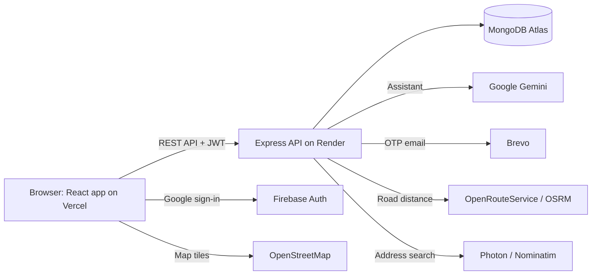

# ChargeHub ⚡ EV Charging Platform

A full-stack platform for finding, booking and running EV charging stations across India. Drivers find the nearest station by real road distance and book a time slot. Station providers verify each session with an emailed one-time code and track their earnings. Admins approve stations, manage accounts and monitor the whole network.


---

## Contents

- [Features](#features)
- [Technical highlights](#technical-highlights)
- [Tech stack](#tech-stack)
- [Architecture](#architecture)
- [Project structure](#project-structure)
- [Getting started](#getting-started)
- [Configuration](#configuration)
- [Scripts](#scripts)
- [API reference](#api-reference)
- [Deployment](#deployment)
- [Acknowledgements](#acknowledgements)

---

## Features

The platform has three roles, each with its own dashboard, plus a public station map anyone can browse.

### EV drivers
- **Find stations near you**, from your device location, a searched address or landmark, a plus code or a pin on the map. Results are sorted by **road distance and drive time**, not straight-line distance.
- **Filter** by vehicle type (car or bike) and online status, and **sort** by distance, price or availability.
- **Book a time slot** up to 30 days ahead. Only times that are free and inside the station's opening hours can be picked.
- **Pay at the station**, then rate the session and download a printable receipt.
- **Ask the AI assistant** (text, voice or photo) to find stations by connector, power, price or opening hours, check bookings, or estimate charging time and cost.
- Report an issue, keep a saved default location, and switch between light and dark themes.

### Station providers
- **Add chargers** with an exact map pin, connector types, power, price and opening hours.
- **Switch stations online or offline** instantly.
- **Verify each session** with a one-time code emailed to the driver. Verifying it completes the booking and records the cash payment.
- **Track earnings and analytics**: monthly bookings, busiest times of day and per-station performance, with CSV export.

### Admins
- **Approve** new stations and provider accounts.
- **Manage** users, providers and other admins: block, approve or remove accounts.
- **Monitor** platform analytics, transactions and revenue, and resolve reported issues.
- **Configure** user and provider sign-ups, maintenance mode and the platform fee percentage.

### Guests
- Browse the full station map at `/stations` without an account. Booking asks them to sign in, then returns them to the same station with the booking form open.

---

## Technical highlights

| Area | Implementation |
|---|---|
| **Road distances** | OpenRouteService gives distance and drive time, with automatic fallback to OSRM and then a clearly marked estimate. Results are cached in MongoDB for 24 h per ~100 m area to stay within free-tier limits. |
| **Location search** | Covers every town, village and address in India: a GeoNames gazetteer stored in MongoDB, Photon and Nominatim for addresses and landmarks, and an Open Location Code (plus code) decoder. Station pins are checked against their address when saved. |
| **Slot booking** | Server-side checks for overlapping bookings, opening hours (including overnight hours) and the 30-day booking window, all in Indian Standard Time. Missed slots are marked as no-shows automatically. |
| **Session OTP** | Codes are stored only as HMAC-SHA256 hashes and compared in constant time. They are limited to 5 attempts, can be resent after 30 s, and can be sent from 30 minutes before the slot. |
| **AI assistant** | Google Gemini with **function calling** over live data (`find_stations`, `get_my_bookings`, `estimate_charge`). It accepts images and voice, and guests can use it, but answers about bookings need a sign-in. |
| **Security** | Passwords hashed with bcrypt (cost 12), JWT sessions, role-based access on every route, Helmet headers, input validation, per-route rate limits (stricter on login and sign-up), and error responses that don't expose internal details in production. |
| **Authentication** | Email and password, or Google sign-in. The Firebase ID token is verified on the server, which then issues its own session. |
| **Performance** | Route-level code splitting, large libraries split into separately cached files, gzip compression and `.lean()` database queries. |
| **Production readiness** | Settings are checked at startup and a missing or wrong one stops the server with a clear message. Also: a health check, graceful shutdown, a wake-up handshake for free-plan cold starts, and a production build that refuses to run without the API URL. |

---

## Tech stack

| Layer | Technologies |
|---|---|
| **Frontend** | React 18, TypeScript, Vite, Tailwind CSS, shadcn/ui (Radix UI), React Router, Zustand, Axios, Recharts, Leaflet |
| **Backend** | Node.js 22, Express, Mongoose, JSON Web Tokens, bcrypt, express-validator, Helmet, express-rate-limit |
| **Database** | MongoDB Atlas |
| **Services** | Firebase Authentication (Google sign-in), Google Gemini (assistant), Brevo (email), OpenRouteService and OSRM (routing), Photon and Nominatim (geocoding), OpenStreetMap (map tiles) |
| **Hosting** | Vercel (frontend), Render (backend) |

---

## Architecture



---

## Project structure

```
├── ChargeHub_backend/          Express REST API
│   ├── config/                 Database connection, startup settings check
│   ├── controllers/            Request handlers, one file per area
│   ├── middleware/             Auth (JWT, roles, maintenance mode), validation, errors
│   ├── models/                 User, Station, Booking, Payment, Report, Settings, Place, CacheEntry
│   ├── routes/                 Route definitions with input validation
│   ├── services/               AI assistant, email, geocoding, routing, slot booking, station search
│   ├── utils/                  Cache, geo maths, plus codes, statistics, text and time helpers
│   ├── server.js               App setup and startup
│   ├── setupAdmin.js           Create or promote an admin
│   ├── importPlaces.js         Load the GeoNames place gazetteer
│   ├── auditLocations.js       Check station pins against their addresses
│   └── seed.js                 Demo stations for an empty database
│
├── ChargeHub_frontend/         React single-page app
│   ├── src/
│   │   ├── pages/              Public pages and user/, provider/, admin/ dashboards
│   │   ├── components/         Shared UI, maps, booking, chat assistant, ui/ (shadcn)
│   │   ├── hooks/              Location, voice, booking and animation hooks
│   │   ├── services/api.ts     Typed API client
│   │   ├── store/              Auth state (Zustand)
│   │   ├── contexts/           Theme and chat state
│   │   └── lib/                Formatting, maps, CSV, receipts, Firebase
│   └── vercel.json             Vercel build, routing and headers
│
└── render.yaml                 Render deployment blueprint
```

---

## Getting started

### Prerequisites
- **Node.js 22** and npm
- A free **MongoDB Atlas** cluster
- API keys for the optional features (see [Configuration](#configuration)). The app runs without them, and only the related feature is turned off.

### 1. Backend

```bash
cd ChargeHub_backend
npm install
cp .env.example .env           # then fill in the values
npm run dev                    # http://localhost:5000
```

One-time setup:

```bash
npm run setup-admin -- admin@example.com "StrongPassword" "Admin Name"   # create the first admin
npm run import-places                                                    # load the place gazetteer used by location search
```

### 2. Frontend

```bash
cd ChargeHub_frontend
npm install
cp .env.example .env           # then fill in the values
npm run dev                    # http://localhost:8080
```

Sign in with the admin account, or create a driver or provider account from the sign-up page.

---

## Configuration

Each app has an `.env.example` listing every variable. `.env` files are git-ignored. In production, set the values in the Render and Vercel dashboards.

### Backend (`ChargeHub_backend/.env`)

| Variable | Required | Purpose |
|---|---|---|
| `MONGODB_URI` | Yes | MongoDB Atlas connection string |
| `JWT_SECRET` | Yes | Random secret for sessions, 32+ characters in production. Generate one: `node -e "console.log(require('crypto').randomBytes(48).toString('hex'))"` |
| `FRONTEND_URL` | In production | Allowed frontend URL(s), comma-separated |
| `JWT_EXPIRE` | No | Session length (default `7d`) |
| `PORT`, `NODE_ENV` | No | Server port (default `5000`) and environment |
| `BREVO_API_KEY`, `EMAIL_FROM` | For OTP emails | Brevo API key and a sender address verified in Brevo |
| `FIREBASE_PROJECT_ID` | For Google sign-in | Firebase project that issues the ID tokens |
| `GEMINI_API_KEY`, `GEMINI_MODEL` | For the assistant | Key from [Google AI Studio](https://aistudio.google.com/apikey) |
| `ORS_API_KEY` | Recommended | [OpenRouteService](https://openrouteservice.org/dev/#/signup) key for road distances (falls back to OSRM without it) |
| `OSRM_URL` | No | Custom OSRM server (defaults to the public one) |

### Frontend (`ChargeHub_frontend/.env`)

| Variable | Purpose |
|---|---|
| `VITE_API_URL` | Backend URL ending in `/api`. Required for production builds. |
| `VITE_FIREBASE_API_KEY`, `VITE_FIREBASE_AUTH_DOMAIN`, `VITE_FIREBASE_PROJECT_ID`, `VITE_FIREBASE_APP_ID` | Firebase web app config (Firebase console → Project settings → Your apps) |

### Google sign-in
1. Firebase console → Authentication → Sign-in method → enable **Google**.
2. Authentication → Settings → **Authorized domains**: add the deployed frontend domain (`localhost` is allowed by default).

---

## Scripts

| Location | Command | Description |
|---|---|---|
| Backend | `npm run dev` / `npm start` | Start the API with auto-reload / in production mode |
| Backend | `npm run setup-admin -- <email> <password> [name]` | Create an admin, or promote an existing account |
| Backend | `npm run import-places` | Load the GeoNames gazetteer (safe to re-run) |
| Backend | `npm run audit:locations` | Report stations whose pin doesn't match their address |
| Backend | `npm run audit:locations:fix` | Back up stations, then correct pins that conflict with a plus code |
| Backend | `npm run seed` | Insert demo stations. ⚠️ **Deletes all users and stations first**, so only use it on an empty database |
| Frontend | `npm run dev` | Start the development server |
| Frontend | `npm run build` / `npm run preview` | Build for production / preview the build |
| Frontend | `npm run lint` | Run ESLint |

---

## API reference

Base URL: `/api`. Every response is JSON in the form `{ success, message?, data? }`. Errors use standard status codes: 400 invalid input, 401 not signed in, 403 not allowed, 404 not found, 409 conflict, 413 too large, 429 rate limited, 503 maintenance.

<details>
<summary><b>Auth</b></summary>

| Method | Endpoint | Access | Description |
|---|---|---|---|
| POST | `/auth/register` | Public | Register a driver or provider |
| POST | `/auth/login` | Public | Email and password login |
| POST | `/auth/google` | Public | Google sign-in with a Firebase ID token |
| GET | `/auth/me` | Signed in | Current user |
| PUT | `/auth/update-profile` | Signed in | Update profile details |
| POST | `/auth/verify-password` | Signed in | Confirm the current password |
| PUT | `/auth/change-password` | Signed in | Change the password |
| DELETE | `/auth/me` | Driver, Provider | Delete own account (cancels upcoming bookings) |
</details>

<details>
<summary><b>Stations</b></summary>

| Method | Endpoint | Access | Description |
|---|---|---|---|
| GET | `/stations` | Public | Approved stations, filterable by city, state and vehicle type |
| GET | `/stations/nearby?lat=&lng=` | Public | Nearest stations with road distance and drive time |
| GET | `/stations/stats` | Public | Landing-page figures |
| GET | `/stations/mine` | Provider | Own stations, including those pending approval |
| POST | `/stations` | Provider | Add a station (pending admin approval) |
| PUT | `/stations/:id` | Owner, Admin | Update a station |
| PATCH | `/stations/:id/availability` | Owner, Admin | Switch online or offline |
| DELETE | `/stations/:id` | Owner, Admin | Remove a station |
</details>

<details>
<summary><b>Bookings</b></summary>

| Method | Endpoint | Access | Description |
|---|---|---|---|
| GET | `/bookings/availability/:stationId` | Driver | Bookable start times for the next 30 days |
| POST | `/bookings` | Driver | Book a slot |
| GET | `/bookings/my-bookings` | Driver | Own bookings |
| PATCH | `/bookings/:id/cancel` | Driver | Cancel before the slot starts |
| POST | `/bookings/:id/rate` | Driver | Rate a completed session (1–5) |
| GET | `/bookings/provider` | Provider | Bookings at own stations |
| POST | `/bookings/:id/otp` | Provider, Admin | Email the session code to the driver |
| POST | `/bookings/:id/verify` | Provider, Admin | Verify the code, complete the session and record the payment |
| DELETE | `/bookings/:id` | Provider, Admin | Remove a past booking from history |
</details>

<details>
<summary><b>Dashboards, reports and notifications</b></summary>

| Method | Endpoint | Access | Description |
|---|---|---|---|
| GET | `/users/stats` | Driver | Dashboard figures and payment history |
| GET | `/providers/stats` | Provider | Dashboard and earnings |
| GET | `/providers/analytics` | Provider | Monthly bookings, time-of-day usage, station performance |
| POST | `/reports` | Driver, Provider | Report an issue |
| GET | `/notifications` | Signed in | Notifications for the signed-in user's role |
</details>

<details>
<summary><b>Admin</b></summary>

| Method | Endpoint | Description |
|---|---|---|
| GET | `/admin/stats` | Dashboard figures |
| GET | `/admin/analytics` | Growth, monthly bookings, top providers |
| GET | `/admin/transactions` | Payments and monthly revenue |
| GET | `/admin/users?role=&search=` | List drivers, providers or admins |
| POST | `/admin/users/admin` | Add an admin |
| PATCH | `/admin/users/:id/block` | Block or unblock an account |
| PATCH | `/admin/users/:id/approve` | Approve a provider |
| DELETE | `/admin/users/:id` | Delete an account |
| GET | `/admin/stations` | All stations, including pending ones |
| PATCH | `/admin/stations/:id/verify` | Approve or reject a station |
| GET, PUT | `/admin/settings` | Sign-ups, maintenance mode, platform fee |
| GET | `/reports` | All reported issues |
| PATCH | `/reports/:id/resolve` | Resolve a report |
| DELETE | `/reports/:id` | Delete a report |
</details>

<details>
<summary><b>Location, assistant and health</b></summary>

| Method | Endpoint | Access | Description |
|---|---|---|---|
| GET | `/geocode/search?q=` | Public | Search places, addresses and landmarks |
| GET | `/geocode/reverse?lat=&lng=` | Public | Name the place at a point |
| GET | `/geocode/check-pin` | Public | Check that a station pin matches its address |
| POST | `/chat` | Public | AI assistant (booking questions need a sign-in) |
| GET | `/health` | Public | Server and database status |
</details>

---

## Deployment

The backend runs on **Render** and the frontend on **Vercel**, both on free plans. Push this whole folder to one GitHub repository first.

### 1. MongoDB Atlas
Network Access → allow `0.0.0.0/0`, because Render's free plan has no fixed IP address.

### 2. Backend on Render
1. Render → **New → Blueprint** → select the repository. [`render.yaml`](render.yaml) sets up the service: free plan, Node 22, health check, production mode and a generated `JWT_SECRET`.
2. Enter the requested values (see [Configuration](#configuration)). Set `FRONTEND_URL` to the Vercel URL from step 3; until you have it, use `http://localhost:8080` and update it later.
3. Open `https://<your-service>.onrender.com/api/health`. It should return `"status":"OK"`.

Run `setup-admin` and `import-places` from your own computer against the same `MONGODB_URI`.

### 3. Frontend on Vercel
1. Vercel → **Add New → Project** → import the repository → set **Root Directory** to `ChargeHub_frontend`.
2. Add the environment variables: `VITE_API_URL=https://<your-service>.onrender.com/api` and the four `VITE_FIREBASE_*` values.
3. Deploy, then put the Vercel URL into Render's `FRONTEND_URL`.

[`vercel.json`](ChargeHub_frontend/vercel.json) handles page routing (refreshing any page works), long-term caching for built files and security headers.

### 4. Final checks
- **Firebase** → Authorized domains: add the Vercel domain.
- **Brevo**: `EMAIL_FROM` must be a verified sender. If emails fail with a 401 error, allow Render's IP addresses under Brevo → Security → Authorized IPs.
- **Free plan cold starts**: Render puts the backend to sleep after 15 idle minutes and takes up to a minute to wake it. The app wakes the server as soon as the site opens, and API calls wait until it is ready. An uptime monitor calling `/api/health` every 10 minutes avoids the wait entirely.

---

## Acknowledgements

- Place data from [GeoNames](https://www.geonames.org), licensed under [CC BY 4.0](https://creativecommons.org/licenses/by/4.0/)
- Map data © [OpenStreetMap](https://www.openstreetmap.org/copyright) contributors
- Routing by [OpenRouteService](https://openrouteservice.org) and [OSRM](https://project-osrm.org)
- Geocoding by [Photon](https://photon.komoot.io) and [Nominatim](https://nominatim.org)
